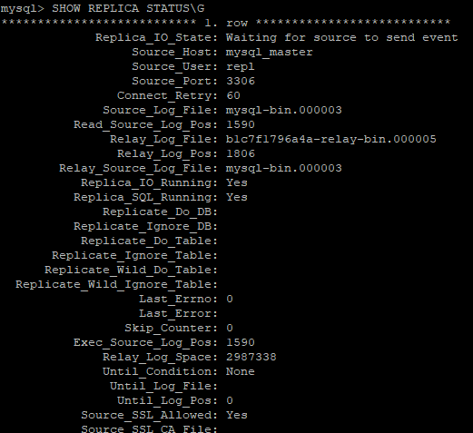
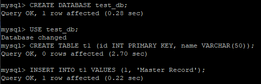
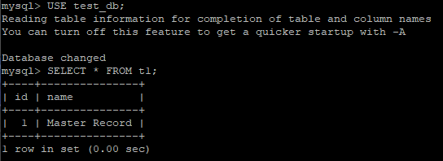

# [Задание](https://github.com/netology-code/sdb-homeworks/blob/main/12-06.md) к занятию "`Репликация и масштабирование. Часть 1`
---

### Задание 1

В репликации `master-slave` master принимает записи, а slave получают копию данных только для чтения, следовательно, в `master-master` на каждом можно делать записи.

Для `master-slave` можно использовать slave для распределения нагрузки на master, а для `master-master` имеем синхронизацию данных (что повышает отказоустойчивать), но есть риск конфликтов записей.

---

### Задание 2

`Создание записи в master`

`Чтение записи в slave`

---
